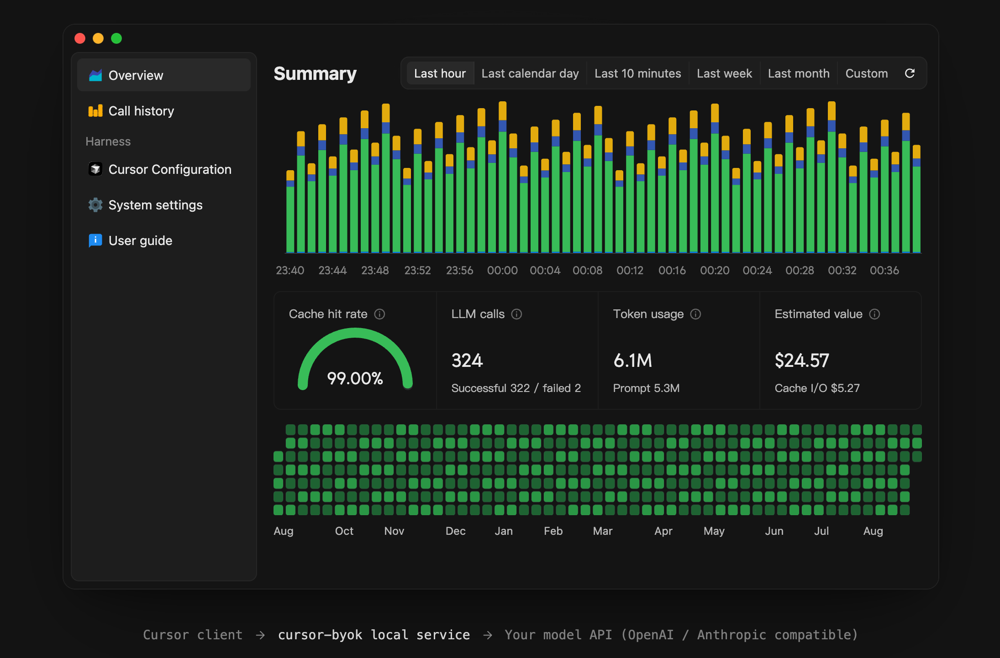

# cursor-byok · 个人修改版

基于 [leookun/cursor-byok](https://github.com/leookun/cursor-byok) 的个人分支，基线 v1.0.0、已同步 v1.0.1。

[English](./README-EN.md) · [上游仓库](https://github.com/leookun/cursor-byok) · [上游文档](https://docs.leokun.cn)

## 下载

Windows x64 安装包（NSIS）：从 [Releases](https://github.com/haxsd/cursor-byok/releases/latest) 下载名称含 `x64-setup.exe` 的文件；应用内更新也指向本仓库的 Release。

## 本分支改了什么

| 改动 | 说明 |
| --- | --- |
| 移除广告 | 去掉桌面端广告位与服务端广告接口，应用不再请求广告服务 |
| 价值估算改分时计价 | 首页「价值估算」按 DeepSeek-V4.1-Flash 高峰 / 低谷单价逐小时计算 |
| 语言精简 | 界面只保留简体中文与英文 |
| 更新地址 | 自动更新指向本仓库 |
| 接管容错 | 终止 Cursor 失败不再中断接管（同步上游 v1.0.1） |
| 存储统计显示真实占用 | 显示数据库文件真实大小（同步上游 v1.0.1 的方向） |

其余功能、代码结构与上游保持一致。每处改动落在哪些文件、为什么这么改，以及构建、验证与同步上游的做法，见 [docs/changes.md](./docs/changes.md)。

> 上游作者把广告注明为该开源项目的唯一收入来源。本仓库只是个人自用分支；喜欢这个项目请到[上游仓库](https://github.com/leookun/cursor-byok)支持作者。

## 许可

沿用上游的 [MIT 许可证](./LICENSE)。原版权归原作者所有，本分支的修改同样以 MIT 许可发布。
